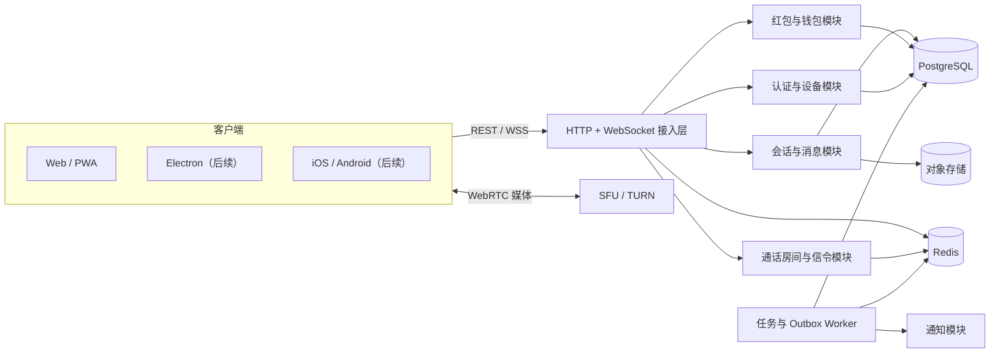

# OpenIM 总体架构设计

## 1. 架构目标

- 客户端通过稳定契约接入，业务代码不依赖 Web 专属实现。
- 消息支持幂等写入、会话内排序、断线补拉和多端同步。
- 音视频媒体与业务服务解耦；业务服务管理房间权限和信令，不代理媒体流。
- 红包账务使用事务、一致性约束和不可变流水，优先保证正确性。
- 演示环境能够单机启动，生产环境有清晰的替换和扩容路径。

## 2. 技术选型

| 层 | MVP | 生产演进 | 选择理由 |
| --- | --- | --- | --- |
| Web 客户端 | React + TypeScript + Vite | PWA / Electron 复用 Web 核心 | 开发反馈快、WebRTC 支持成熟 |
| 状态管理 | React Context + hooks | Zustand/Query（复杂后引入） | 首版依赖少、状态边界清楚 |
| 服务端 | Java 21 + Spring Boot 3.5 | 按领域拆服务或保持模块化单体 | 企业级事务、验证、监控与长期治理成熟 |
| 实时层 | Spring 原生 WebSocket + JSON Envelope | Redis Pub/Sub / MQ 跨实例扇出 | 协议简单、无专有 Socket 客户端依赖 |
| 契约 | Java Records + Bean Validation + TypeScript 类型 | OpenAPI/AsyncAPI 生成 SDK | 两端保持 JSON 字段和事件语义一致 |
| 持久化 | MVP 内存仓储 | PostgreSQL | 事务、一致性与审计能力成熟 |
| 缓存/协调 | 单进程状态 | Redis Cluster | 在线状态、限流、Pub/Sub、分布式锁 |
| 媒体 | 浏览器 WebRTC Mesh | LiveKit/mediasoup SFU + TURN | 小房间简单，规模增长后可替换 |
| 文件 | 本地/占位 URL | S3 兼容对象存储 + CDN | 业务库不存大对象 |
| 任务 | 进程内定时器 | 持久化 Outbox + 队列 Worker | 处理退款、通知和补偿 |

## 3. 逻辑架构



MVP 将接入层和各领域模块部署为一个进程，并使用内存仓储；模块边界、接口和事件仍按上图组织，防止演示实现渗透到领域规则。

## 4. Monorepo 结构

```text
open-im/
├── apps/
│   ├── web/                 # React Web/PWA 客户端
│   └── server/              # Java 21 + Spring Boot 服务端
├── packages/
│   └── contracts/           # 请求、响应、事件与领域类型
├── docs/
│   ├── 00-product/
│   ├── 01-architecture/
│   ├── 02-features/
│   └── 03-delivery/
├── package.json
└── pnpm-workspace.yaml
```

Web 客户端依赖 `packages/contracts`；Spring Boot 通过 Java Records 和 Bean Validation 实现同一 JSON 契约。生产阶段应由 OpenAPI/AsyncAPI 自动生成两端模型，避免人工漂移。

## 5. 服务端模块边界

### 5.1 Auth / Device

- 验证身份、签发/刷新/撤销令牌。
- 建立 `userId + deviceId + connectionId` 映射。
- 将用户级事件扇出到该用户所有在线设备。

### 5.2 Conversation / Message

- 维护单聊/群聊与成员关系。
- 校验成员资格并按会话生成 `seq`。
- 使用 `senderId + clientMessageId` 保证幂等。
- 写入后通过 Outbox/实时网关广播；同步接口是恢复事实的来源。

### 5.3 Call

- 管理房间、邀请、参与者和状态机。
- 校验信令发送者和目标是否属于房间。
- 向目标账号的所有设备推送邀请；接听后执行跨端收敛。
- MVP 转发 SDP/ICE；生产使用 SFU Token/API 取代 Mesh 信令，但保留业务事件。

### 5.4 Wallet / Red Packet

- 维护账户、可用余额、账务流水、红包与份额。
- 发送、领取、过期退款均为短事务。
- 对外返回业务结果，不暴露内部余额更新或随机分配细节。

### 5.5 Notification / Worker

- 消费事务 Outbox，驱动 WebSocket、离线推送和补偿任务。
- 扫描过期红包、过期通话邀请和失败事件。
- 使用事件 ID 幂等消费，失败可重放。

## 6. 数据与一致性策略

| 数据 | 一致性 | 策略 |
| --- | --- | --- |
| 消息落库 | 强一致（单次写入） | 唯一幂等键 + 会话序号事务 |
| 在线推送 | 至少一次 | 事件 ID 去重，失败后由同步接口补偿 |
| 未读数 | 最终一致 | 以读取游标重算，缓存仅用于展示优化 |
| 通话信令 | 短暂、尽力实时 | 房间状态持久/缓存，陈旧事件按房间状态丢弃 |
| 红包领取 | 强一致 | 行锁/条件更新 + 唯一领取约束 + 账务事务 |
| 红包卡片状态 | 最终一致 | 红包事实写入后广播状态事件 |

### 6.1 消息顺序

- 每个会话维护独立的 `next_seq`。
- 消息创建事务锁定会话序号，生成下一 `seq` 后写消息和 Outbox。
- 客户端按 `(conversationId, seq)` 去重排序；发现缺口时调用历史接口。
- 多个设备同时发送时，展示顺序以服务端 `seq` 为准，客户端时间只用于发送前占位。

### 6.2 可靠事件

生产环境将领域变更和 Outbox 事件写入同一事务。Worker 锁定未发布事件，发送到 WebSocket Pub/Sub 或任务队列后记录尝试和完成时间。消费者用事件 ID 幂等处理，因此允许至少一次投递。

## 7. 实时连接协议

1. 客户端使用 HTTP 登录取得访问令牌。
2. 原生 WebSocket 连接 `/ws`，握手携带短期 `token` 和持久化 `deviceId`。
3. 服务端鉴权并将连接加入 `user:{userId}` 与相关 `conversation:{id}` 房间。
4. 客户端先执行游标同步，再设置 `realtimeReady=true`。
5. 命令事件必须得到显式 ACK；通知事件包含稳定事件 ID。
6. 断线按 1s、2s、4s…最大 30s 加随机抖动重连，恢复后重新同步。

## 8. 部署拓扑

### 8.1 本地/MVP

- `web`：Vite 开发服务器或静态构建。
- `server`：单 Spring Boot/Tomcat 进程，内存种子数据。
- 浏览器标签页作为多个演示客户端。

### 8.2 生产建议

- CDN 托管静态客户端；API 网关终止 TLS。
- 无状态 API/WebSocket 节点水平扩展，Redis Pub/Sub 或消息队列负责跨节点广播。
- PostgreSQL 主从/高可用，Redis Cluster，S3 兼容存储。
- 独立 Worker 处理 Outbox、红包过期与离线通知。
- 独立 SFU 与 TURN 集群；API 服务只下发令牌和业务状态。

## 9. 可观测性

- 每个 HTTP 请求、WebSocket 命令和领域事件携带 `requestId/eventId`。
- 日志字段：时间、级别、模块、操作、用户/设备匿名标识、耗时、结果、错误码。
- 指标：连接数、消息写入/推送延迟、同步缺口、呼叫建连率、ICE 状态、红包领取冲突、账务不平检查。
- 链路：客户端请求 ID → 网关 → 领域服务 → 数据库/Outbox → 推送。
- 任何日志不得记录访问令牌、SDP 全文、消息敏感正文、完整 IP 或资金凭证。

## 10. 关键架构决策记录（ADR 摘要）

| 决策 | 结果 | 原因 | 代价 |
| --- | --- | --- | --- |
| 首版模块化单体 | 接受 | 交付快且保留边界 | 单进程故障域，生产需外部状态 |
| 会话级序号 | 接受 | 顺序和补拉简单可靠 | 写热点群需分区/批量优化 |
| Mesh 仅用于小房间 | 接受 | 无媒体服务即可演示 | 上行带宽 O(n)，最多 6 人 |
| 红包预分配份额 | 接受 | 领取事务短、结果可审计 | 创建成本随份数增加 |
| WebSocket 推送至少一次 | 接受 | 故障模型现实、易恢复 | 客户端必须去重和补拉 |

## 11. 从 MVP 到生产的差距

MVP 内存数据会在进程重启后丢失，不可用于真实业务；演示令牌和虚拟余额也不具备生产安全等级。进入业务可用阶段前，至少需要完成 PostgreSQL/Redis 适配、迁移脚本、TURN、对象存储、可靠 Outbox、限流、密钥管理、离线推送、备份恢复和安全测试。
