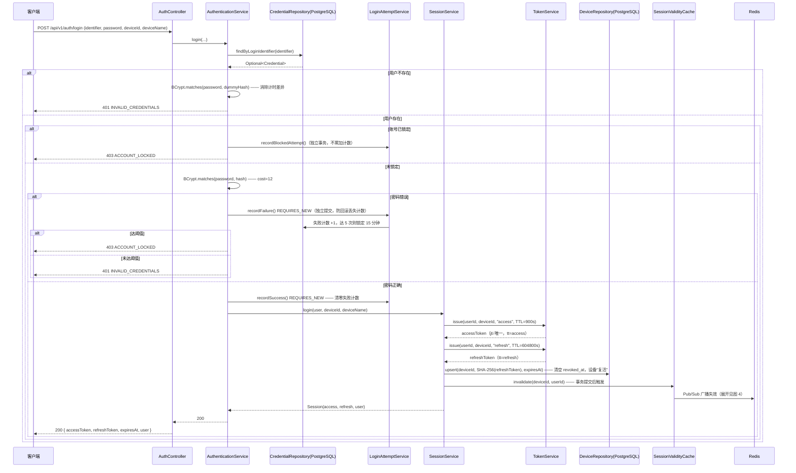
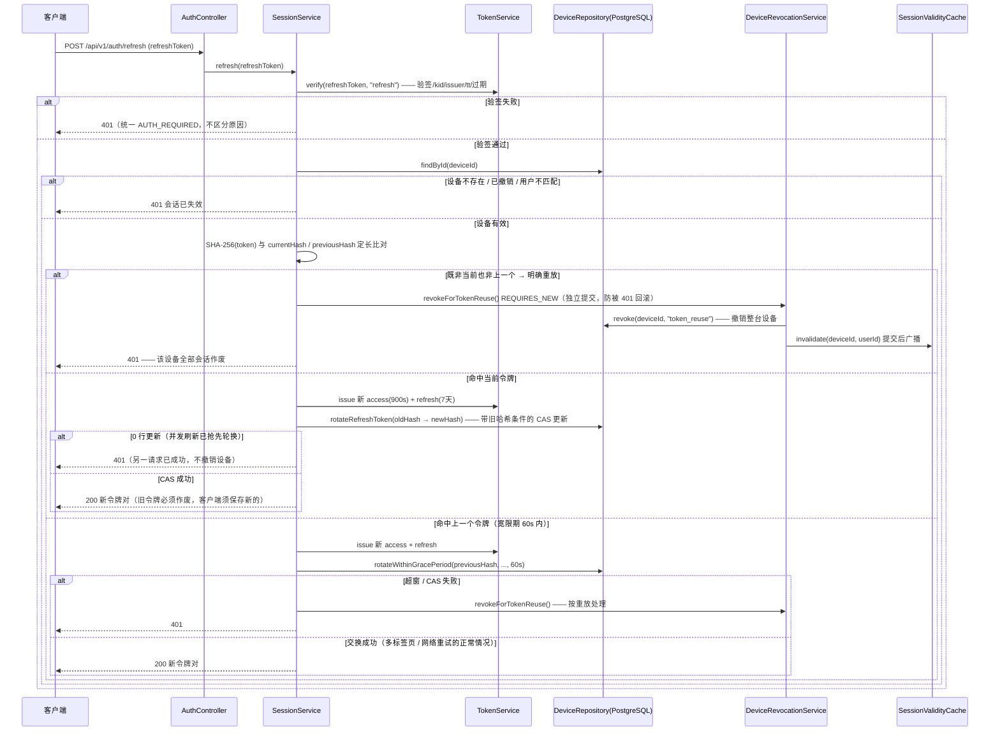
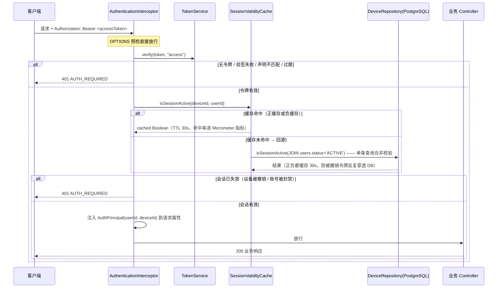
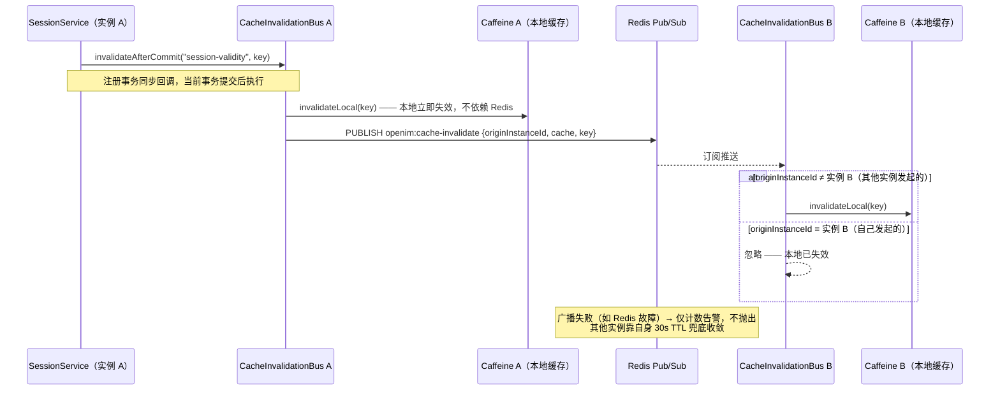

# 认证与缓存机制时序图

> 基于当前实现（Redis 缓存改造完成后）梳理：登录认证、Token 刷新、请求鉴权与会话有效性缓存。
> 相关源码：`apps/server/src/main/java/com/openim/server/{auth,web,cache}`

## 系统组件总览

| 组件 | 职责 | 关键参数（默认值） |
|---|---|---|
| `AuthController` | 无会话入口：`/login`、`/register`、`/refresh`、密码重置 | 失败统一 401/403 |
| `AuthenticationService` | 凭证比对、失败锁定、签发入口 | BCrypt cost=12（约 200–400ms） |
| `LoginAttemptService` | 失败计数/锁定（**REQUIRES_NEW 独立事务**，落 PostgreSQL） | 5 次失败锁 15 分钟 |
| `SessionService` | 会话编排：签发/轮换/撤销，刷新令牌只存 SHA-256 哈希 | access 900s / refresh 7 天 / 宽限 60s |
| `TokenService` | JWS（HS256）签发与验签，`tt` 声明区分 access/refresh | 时钟偏移容忍 30s |
| `DeviceRepository` | `devices` 表，CAS 式令牌轮换 | — |
| `SessionValidityCache` | Caffeine 本地缓存（**正负结果都缓存**），会话有效性查询 | TTL 30s，容量 5 万 |
| `CacheInvalidationBus` | Redis Pub/Sub 跨实例失效广播，事务提交后触发 | 失败降级为等 TTL |
| `AuthenticationInterceptor` | 每个受保护请求：验签 + 查缓存 + 注入 `AuthPrincipal` | — |

## 图 1：凭证登录（正常路径 + 失败/锁定路径）

> 安全要点：`/register` 走同一签发链路（唯一约束防并发冲突，冲突统一 `IDENTIFIER_TAKEN`）；`/demo-login` 仅非 prod 生效，直接查用户后进 `SessionService.login`。失败计数与锁定**落在 PostgreSQL 而非 Redis**——Redis 是可降级组件，锁定必须多实例共享且可靠。

## 图 2：Token 刷新（一次性轮换 + 重放检测）

> 核心语义：**每次刷新都签发新刷新令牌并作废旧的**。已被轮换掉的令牌再次出现，即判定为传输/存储环节被窃取，立即撤销该设备全部会话，把损失限制在单台设备（refresh token rotation with reuse detection）。并发刷新靠 CAS 条件（`WHERE refresh_token_hash = :expectedHash`）保证只有一个成功。

## 图 3：请求鉴权与会话有效性缓存

> 为什么每请求都查缓存而不是只信令牌：**令牌有效 ≠ 会话有效**——远程下线、令牌重放撤销、封号必须快速生效，而非等 access token 自然过期（900s）。缓存的代价是把"撤销立即生效"放宽为"一次网络往返（广播）内生效，Redis 故障时最坏 30s"——仍比等过期快 30 倍。

## 图 4：跨实例缓存失效广播（CacheInvalidationBus）

**失效触发点全景**（写路径全部经 `invalidateAfterCommit`，避免事务内广播引发"旧值被重新缓存"竞态）：

| 触发场景 | 失效范围 | 调用方 |
|---|---|---|
| 登录成功（设备复活） | 单设备 key | `SessionService.login` |
| 登出 / 远程下线 | 单设备 key | `SessionService.logout` |
| 令牌重放检测 | 单设备 key | `DeviceRevocationService` |
| 改密 / 退出全部设备 | **全部清空**（`*`） | `SessionService.logoutAllDevices` |
| 密码重置成功 | 全部清空（经全设备撤销） | `PasswordResetService` |
| 账号注销/封禁 | 全部清空 | `AccountDeletionService` 等 |

> 设计取舍：失效广播用 Pub/Sub 而消息投递用 Redis Streams——失效通知丢失至多多用一个 TTL 的陈旧数据（有界、可自愈），所以不重试、不持久化、不确认；所有接入缓存的组件都必须自带 TTL 兜底。`invalidateAll` 用于受影响设备集合未知的批量操作，代价仅是其他用户多一次回源。

## 关键机制小结

1. **双令牌模型**：access（15 分钟，无状态验签）+ refresh（7 天，有状态哈希存库、一次性轮换）；刷新令牌被盗用的损失被"单设备撤销"封顶。
2. **数据库是正确性来源，Redis 是性能优化**：失败锁定、令牌哈希、CAS 轮换都在 PostgreSQL；Redis 只承担跨实例缓存失效广播（可降级）。
3. **三处独立事务（REQUIRES_NEW）**：失败计数、令牌重放撤销、缓存失效注册——都因"调用方随后抛异常会连带回滚"而必须独立提交，否则撤销/锁定永远不生效。
4. **缓存两级防线**：本地 Caffeine（30s TTL，正负结果都缓存）+ Redis Pub/Sub 主动失效，把每请求一次 DB 往返降为内存命中。
