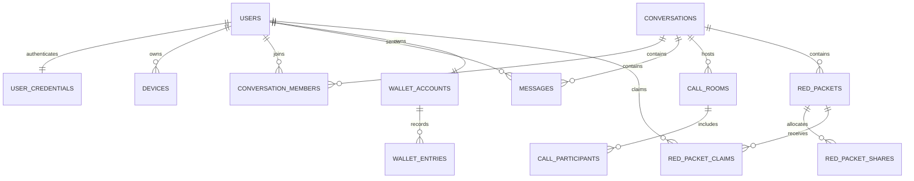
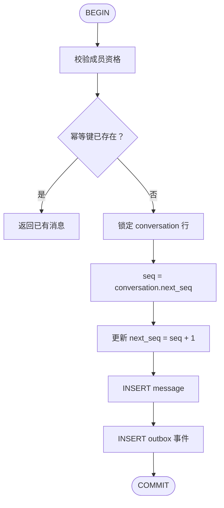
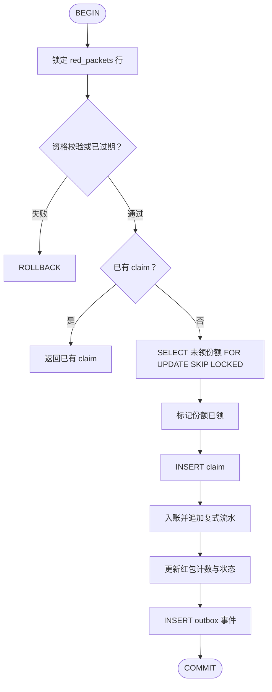

# 数据模型设计

## 1. 建模约定

- 主键使用 UUID/ULID；时间使用 UTC `timestamptz`，客户端按本地时区显示。
- 金额使用 `bigint` 整数分，禁止浮点数。
- 枚举使用 `varchar` + `CHECK` 约束而非 PG enum 类型，便于后续增加取值时无需 `ALTER TYPE`。
- 核心事实（消息、账务、审计）只追加或改状态，不物理删除。
- 所有可重试写请求使用唯一幂等键和数据库唯一约束。
- 表名为复数蛇形命名，示例字段省略通用的 `created_at/updated_at`。

## 2. 核心实体关系

## 3. 表设计

### 3.1 用户与设备

#### `users`

用户主体。被 14 处外键引用（消息、会话成员、钱包账户、账务流水、红包、通话、审计），
因此注销走**匿名化而非物理删除**：清除全部可识别信息、保留结构性引用，否则账务流水
会被连带删除、群聊历史消息会失去发送者。见 `AccountDeletionService`。

| 字段 | 类型 | 作用/约束 |
| --- | --- | --- |
| `id` | uuid | PK，用户唯一标识 |
| `username` | varchar(64) | UNIQUE，登录标识。匿名化后改写为 `deleted_<id>` 以保证唯一 |
| `email` | varchar(254) | 可空，联系邮箱与登录标识之一。唯一性按 `lower(email)` 判定且排除已删除账号 |
| `display_name` | varchar(64) | 非空，界面展示名 |
| `avatar` | varchar(16) | 可空，展示名首字符占位 |
| `status` | varchar(16) | ACTIVE/FROZEN/DELETED。DELETED 表示已注销 |
| `presence` | varchar(16) | online/offline，实时在线状态。单实例由连接注册表维护，多实例后迁移到 Redis |
| `last_seen_at` | timestamptz | 可空，最近在线时间 |
| `deleted_at` | timestamptz | 可空，注销时间。非空即表示用户已注销 |
| `anonymized_at` | timestamptz | 可空，匿名化完成时间。与 `deleted_at` 分开，用于追踪异步清除是否完成 |

邮箱的唯一索引建在 `lower(email)` 上且排除已删除账号：邮箱本地部分理论上
区分大小写，但实践中所有主流服务商都不区分，允许 `Alice@x.com` 和
`alice@x.com` 同时注册只会造成账号混淆和找回歧义。

#### `user_credentials`

密码凭证。与 `users` 分表存储：`users` 会被大量只读查询命中（会话列表、成员展示），
凭证列跟着进缓存和日志的风险没有必要承担；后续接入短信/OAuth 时一个用户会有
多种凭证，分表是自然的扩展点。

| 字段 | 类型 | 作用/约束 |
| --- | --- | --- |
| `user_id` | uuid | PK，FK users，与用户一对一 |
| `password_hash` | text | BCrypt cost 12，含算法标识与 salt。日志与指标中禁止出现本表任何字段的值 |
| `password_changed_at` | timestamptz | 密码最后变更时间。改密使令牌失效由 `devices.revoked_at` 保证，此列是审计与排查用的事实记录 |
| `failed_attempts` | int | 连续失败次数，成功登录清零，达到阈值后锁定 |
| `locked_until` | timestamptz | 可空，锁定截止时间。锁定判定用 `locked_until > now()`，无需定时解锁任务 |
| `last_login_at` | timestamptz | 可空，最近登录时间 |

失败计数与锁定存数据库而非 Redis：多实例下必须共享同一份计数才能真正限制撞库，
而 Redis 在本项目中是可降级组件（限流在故障时放行），把账号锁定建立在可降级的
存储上等于给撞库留了一个开关。

#### `password_reset_tokens`

密码重置令牌。令牌只存哈希，明文只在发送给用户的那一次出现。单独一张表而非往
`user_credentials` 加列：一个用户可以先后请求多次重置（一对多），且令牌需要独立的
过期与"已使用"状态；保留历史还用于排查"是谁在什么时候重置了这个账号"。

| 字段 | 类型 | 作用/约束 |
| --- | --- | --- |
| `id` | uuid | PK |
| `user_id` | uuid | FK users，归属账号 |
| `token_hash` | text | UNIQUE，SHA-256 十六进制。数据库泄漏时无法直接用它重置密码 |
| `expires_at` | timestamptz | 非空，过期时间，清理任务按此扫描 |
| `used_at` | timestamptz | 可空。非空即不可再用，同时记录了使用时间——排查账号被接管时的关键证据 |
| `requested_ip_hash` | varchar(64) | 可空，请求来源 IP 的带盐哈希。带部署级盐值——无盐的 IP 哈希可被完全枚举反查 |

#### `devices`

设备会话。一台设备一行，承载刷新令牌轮换与远程下线。令牌只存哈希；
撤销是软删（`revoked_at` 置位）而非删行——令牌重放检测需要已撤销设备仍然可查。

| 字段 | 类型 | 作用/约束 |
| --- | --- | --- |
| `id` | varchar(128) | PK，客户端生成的稳定设备 ID |
| `user_id` | uuid | FK users，设备归属 |
| `platform` | varchar(16) | WEB/DESKTOP/IOS/ANDROID |
| `name` | varchar(128) | 用户可识别名称 |
| `refresh_token_hash` | text | 当前刷新令牌的哈希。重用已轮换的令牌触发设备撤销 |
| `refresh_token_expires_at` | timestamptz | 可空，当前令牌过期时间，供清理任务回收长期不活跃的设备记录 |
| `refresh_token_rotated_at` | timestamptz | 可空，上次令牌轮换时间 |
| `previous_refresh_token_hash` | text | 可空，上一个令牌的哈希。仅在轮换后的宽限期内可用于再次交换，消除并发/重试误判 |
| `last_active_at` | timestamptz | 最近活跃时间 |
| `revoked_at` | timestamptz | 可空，撤销时间。非空即该设备不可再使用 |
| `revoked_reason` | varchar(64) | 可空，撤销原因：logout / token_reuse / admin / user_frozen。token_reuse 表示检测到令牌重放 |

索引：`(user_id, last_active_at desc)`；`(user_id) WHERE revoked_at IS NULL`（按用户
批量撤销）；`(refresh_token_expires_at) WHERE revoked_at IS NULL`（清理任务扫描）。

### 3.2 会话与消息

#### `conversations`

会话（单聊/群聊）。`next_seq` 是会话内消息序号的唯一来源，写消息时在事务内锁定
本行后自增——序号的连续性由行锁而非应用层保证。

| 字段 | 类型 | 作用/约束 |
| --- | --- | --- |
| `id` | uuid | PK |
| `type` | varchar(16) | direct/group |
| `title` | varchar(64) | 群聊必填，由 `CHECK (type <> 'group' OR title IS NOT NULL)` 保证 |
| `avatar` | varchar(16) | 可空，展示占位 |
| `owner_id` | uuid | FK users，可空，群主 |
| `next_seq` | bigint | 默认 1，下一个消息序号，事务内更新 |
| `last_message` | text | 可空，最近一条消息的摘要文本，会话列表展示用 |
| `last_active_at` | timestamptz | 最近活跃时间，排序依据 |

#### `direct_conversation_keys`

单聊去重键。写入时按字典序把两个用户 ID 规范化为 `(low, high)`，联合主键加
`CHECK (user_low_id < user_high_id)` 使"相同两人只能有一个单聊"成为数据库约束
而不是应用层的先查后写——后者在并发下会创建出两个单聊。

| 字段 | 类型 | 作用/约束 |
| --- | --- | --- |
| `user_low_id` | uuid | 联合 PK/FK，字典序较小者 |
| `user_high_id` | uuid | 联合 PK/FK，字典序较大者 |
| `conversation_id` | uuid | FK conversations，该两人对应对话 |

#### `conversation_members`

会话成员关系。退群是软删（`left_at` 置位）而非删行：`read_seq` / `join_seq`
要保留到重新入群时按当时序号重置，使退群期间的消息同样不可见；软删还保留了
"这个人曾经在群里"的事实，成员变更审计需要它。

| 字段 | 类型 | 作用/约束 | 是否已被代码使用 |
| --- | --- | --- | --- |
| `conversation_id` | uuid | 联合 PK/FK | ✅ |
| `user_id` | uuid | 联合 PK/FK | ✅ |
| `role` | enum | MEMBER/ADMIN/OWNER，权限矩阵见 `MemberRole` | ✅ |
| `joined_at` | timestamptz | 非空。复活退群成员时重置 | ✅ |
| `left_at` | timestamptz | 可空。退群是软删而非删行 | ✅ |
| `read_seq` | bigint | 默认 0。已读游标，未读数 = `next_seq - 1 - read_seq` | ✅ |
| `join_seq` | bigint | 默认 0（V8）。历史可见下界 | ✅ |
| `muted` | boolean | 默认 false，免打扰 | ❌ 免打扰未实现 |
| `pinned_at` | timestamptz | 可空，会话置顶 | ❌ 会话置顶未实现 |

> **"是否已被代码使用"这一列是有意加的。** `role`、`muted`、`pinned_at` 自建表起就
> 存在，但直到补上会话成员管理之前**没有一行代码读写它们**——schema 里的取值会让人
> 相信能力存在，而能力并不存在（`users.status` 的 `'DELETED'` 曾经也是如此，
> 见 `AccountDeletionService` 的类注释）。新增预留字段时请一并标注状态。

**`join_seq` 的作用**：成员的历史消息可见下界。历史查询取
`max(afterSeq, join_seq)`，因此新成员看不到入群之前的消息，退群再入群的人也看不到
离开期间的消息。没有它的话"把某人加进群"等同于"把这个群的全部历史交给他"，
而加人只需要管理员权限、被泄露方毫无感知。存量成员取默认值 0（可见全部历史），
这对他们是正确的：迁移之前不存在加人路径，现有成员都是建群时就在的。

**退群为什么是软删**：`read_seq` / `join_seq` 需要保留，重新入群时是 UPDATE 而非
INSERT（`ON CONFLICT (conversation_id, user_id) DO UPDATE ... WHERE left_at IS NOT NULL`），
此时两个游标都重置为当时的序号。软删还保留了"这个人曾经在群里"的事实，
成员变更审计需要它。

#### `messages`

消息事实。只追加或改 `status`（RECALLED / DELETED），不物理删除。
`(conversation_id, seq)` 唯一保证会话内有序不重，`(sender_id, client_message_id)`
唯一提供发送幂等——重试依赖约束去重而非先查后写。刻意不按时间分区，理由见
V7 迁移注释（查询全是 `conversation_id + seq` 范围，时间分区会让一次历史拉取
跨多个分区；且分区会破坏 `red_packets.message_id` 的外键）。

| 字段 | 类型 | 作用/约束 |
| --- | --- | --- |
| `id` | uuid | PK |
| `conversation_id` | uuid | FK conversations，所属会话 |
| `seq` | bigint | 会话内序号，从 1 开始。`(conversation_id, seq)` 唯一 |
| `sender_id` | uuid | FK users，发送者 |
| `client_message_id` | varchar(128) | 客户端生成的幂等键。`(sender_id, client_message_id)` 唯一，重试发送依赖约束去重 |
| `type` | varchar(16) | text/image/file/system/call/red_packet，决定 `content` 的校验规则 |
| `content` | jsonb | 按类型校验的负载 |
| `status` | varchar(16) | ACTIVE/RECALLED/DELETED。撤回/删除是改状态而非删行 |
| `sent_at` | timestamptz | 服务端时间 |

唯一约束：`(conversation_id, seq)`、`(sender_id, client_message_id)`；历史索引：`(conversation_id, seq desc)`。

### 3.3 通话

#### `call_rooms`

通话房间与生命周期。只记录元数据（媒体类型、拓扑、起止时间、结束原因）；
SDP/ICE 等信令内容不落库，它们只在信令通道中传递。

| 字段 | 类型 | 作用/约束 |
| --- | --- | --- |
| `id` | uuid | PK |
| `conversation_id` | uuid | FK conversations，通话所在会话 |
| `creator_id` | uuid | FK users，发起人 |
| `media_type` | varchar(16) | audio/video |
| `topology` | varchar(16) | MESH/SFU，默认 MESH |
| `status` | varchar(16) | ringing/active/ended |
| `idempotency_key` | varchar(128) | 与 `creator_id` 组成唯一键，防重复拨号 |
| `expires_at` | timestamptz | 非空，邀请超时 |
| `started_at` | timestamptz | 可空，接通时间 |
| `ended_at` | timestamptz | 可空，结束时间 |
| `end_reason` | varchar(64) | 可空，结束原因 |

索引：`(conversation_id, created_at desc)`（会话通话列表）；
`(status) WHERE status <> 'ended'`（未结束通话的忙线检测）。

#### `call_participants`

通话参与者状态。记录每个被邀请者 invited → ringing → joined / rejected / left / missed
的流转，是通话记录展示与忙线判定的依据。

| 字段 | 类型 | 作用/约束 |
| --- | --- | --- |
| `room_id` | uuid | 联合 PK，FK call_rooms |
| `user_id` | uuid | 联合 PK，FK users |
| `state` | varchar(16) | invited/ringing/joined/rejected/left/missed |
| `joined_device_id` | varchar(128) | 可空，实际接听设备 |
| `joined_at` | timestamptz | 可空，接听时间 |
| `left_at` | timestamptz | 可空，离开时间 |

索引：`(user_id) WHERE state = 'joined'`（用户忙线查询）。

### 3.4 钱包与红包（复式记账）

#### `wallet_accounts`

账户。区分用户账户与系统托管账户——红包资金在"已发出未领取"期间挂在 SYSTEM
托管账户上（`purpose = 'RED_PACKET_ESCROW'`），使任意时刻全部账户余额之和恒定、
可对账。余额的每一次变动都必须有对应的 `wallet_entries` 流水。

| 字段 | 类型 | 作用/约束 |
| --- | --- | --- |
| `id` | uuid | PK |
| `owner_type` | varchar(16) | USER/SYSTEM，决定账户种类 |
| `user_id` | uuid | FK users，可空。USER 账户必填（CHECK），SYSTEM 账户必须为空（CHECK） |
| `purpose` | varchar(32) | 默认 GENERAL。系统账户的用途标识，如 RED_PACKET_ESCROW |
| `currency` | char(3) | 默认 CNY，演示使用 CNY 单位体系 |
| `available_balance` | bigint | CHECK >= 0，可用余额 |
| `frozen_balance` | bigint | CHECK >= 0，冻结余额 |
| `version` | bigint | 乐观锁版本，更新时校验 |

唯一索引：USER 账户按 `(user_id, currency)`，同一用户同一币种一个账户；
SYSTEM 账户按 `(purpose, currency)`。

#### `wallet_transactions`

账务交易。一笔业务一行，其下的 `wallet_entries` 借贷合计必须相等。
`idempotency_key` 的唯一约束是重试去重的唯一依据——重复请求会撞约束失败，
而不是产生第二笔资金变动。

| 字段 | 类型 | 作用/约束 |
| --- | --- | --- |
| `id` | uuid | PK |
| `type` | varchar(32) | RED_PACKET_SEND/CLAIM/REFUND/REVERSAL |
| `business_id` | uuid | 可空，红包或冲正业务 ID，按此关联业务 |
| `idempotency_key` | varchar(160) | UNIQUE，重试去重键 |
| `status` | varchar(16) | PENDING/COMMITTED/REVERSED |

#### `wallet_entries`

不可变流水。DEBIT 表示账户资金减少，CREDIT 表示增加；同一 `transaction_id` 下
两者合计必须相等。真实资金系统建议使用独立复式记账服务，本模型只作为虚拟资产基线。

| 字段 | 类型 | 作用/约束 |
| --- | --- | --- |
| `id` | uuid | PK |
| `transaction_id` | uuid | FK wallet_transactions，所属交易 |
| `account_id` | uuid | FK wallet_accounts，变动账户 |
| `direction` | varchar(8) | DEBIT/CREDIT |
| `amount` | bigint | CHECK > 0，变动金额 |
| `balance_after` | bigint | CHECK >= 0，变动后余额快照（审计） |

#### `red_packets`

红包主体。`claimed_amount` / `claimed_count` 是领取的聚合状态，明细在
`red_packet_shares` 与 `red_packet_claims`，三者必须一致（CHECK 保证不超发）。
过期未领由 Worker 按 `expires_at` 扫描并退款给发送者。

| 字段 | 类型 | 作用/约束 |
| --- | --- | --- |
| `id` | uuid | PK |
| `conversation_id` | uuid | FK conversations，所属会话 |
| `sender_id` | uuid | FK users，发送者 |
| `message_id` | uuid | FK messages，关联的红包消息（type = red_packet） |
| `mode` | varchar(16) | fixed/equal/random，分配方式 |
| `total_amount` | bigint | CHECK > 0，总金额 |
| `total_count` | int | CHECK > 0，总份数 |
| `claimed_amount` | bigint | 默认 0，已领取金额 |
| `claimed_count` | int | 默认 0，已领取份数 |
| `greeting` | varchar(60) | 非空，祝福语 |
| `status` | varchar(24) | published/partially_claimed/exhausted/expired/refunded |
| `expires_at` | timestamptz | 非空，过期时间，Worker 按此退款 |
| `idempotency_key` | varchar(128) | 与 `sender_id` 组成唯一键，防重复发红包 |

索引：`(expires_at) WHERE status IN ('published', 'partially_claimed')`（过期退款 Worker 扫描）。

#### `red_packet_shares`

预分配份额。创建红包时一次性分完金额，领取只是把某一份标记为已领，
使领取事务足够短。并发领取用 `FOR UPDATE SKIP LOCKED` 抢占未领份额，
避免同一红包的领取请求相互阻塞。

| 字段 | 类型 | 作用/约束 |
| --- | --- | --- |
| `id` | uuid | PK |
| `red_packet_id` | uuid | FK red_packets，所属红包 |
| `ordinal` | int | 份额序号，与红包组成 UNIQUE |
| `amount` | bigint | CHECK > 0，本份金额 |
| `claimed_by` | uuid | FK users，可空，领取用户 |
| `claimed_at` | timestamptz | 可空，领取时间 |

索引：`(red_packet_id) WHERE claimed_by IS NULL`（未领份额扫描）。

#### `red_packet_claims`

领取凭证。`(red_packet_id, user_id)` 唯一是防并发套利的最后一道防线，即使
应用层判断失效也会被数据库拒绝。属账务凭证，账号注销时保留。

| 字段 | 类型 | 作用/约束 |
| --- | --- | --- |
| `id` | uuid | PK |
| `red_packet_id` | uuid | FK red_packets，所属红包 |
| `share_id` | uuid | UNIQUE，FK red_packet_shares，领到的份额（一份只能被领一次） |
| `user_id` | uuid | FK users，领取者 |
| `amount` | bigint | CHECK > 0，领取金额 |
| `idempotency_key` | varchar(128) | 与 `user_id` 组成唯一键，请求幂等 |
| `claimed_at` | timestamptz | 领取时间 |

唯一约束：`(red_packet_id, user_id)`、`(user_id, idempotency_key)`。

### 3.5 可靠事件与审计

#### `outbox_events`

事务性发件箱。领域变更与事件写入同一事务，由 Worker 轮询发布，保证至少一次
投递——因此消费方必须幂等。`attempts` / `next_attempt_at` 支撑失败退避重试，
`last_error` 留给排查。

| 字段 | 类型 | 作用/约束 |
| --- | --- | --- |
| `id` | uuid | PK |
| `aggregate_type` | varchar(32) | 聚合类型，如 CONVERSATION/USER |
| `aggregate_id` | uuid | 聚合 ID，与类型共同定位业务实体 |
| `event_type` | varchar(64) | 事件类型，如 MessageCreated/RedPacketClaimed |
| `payload` | jsonb | 事件负载 |
| `occurred_at` | timestamptz | 领域事件发生时间 |
| `published_at` | timestamptz | 可空，发布成功后置值 |
| `attempts` | int | 已尝试发布次数 |
| `next_attempt_at` | timestamptz | 下次重试时间，退避依据 |
| `last_error` | text | 可空，最后一次失败原因 |

部分索引 `(next_attempt_at) WHERE published_at IS NULL` 只覆盖未发布事件，
供 Worker 按退避到期时间扫描。

#### `audit_logs`

只追加的审计流水，按月 RANGE 分区（`created_at`）。登录、设备变更、账务交易、
冲正和策略变更必须留痕；`ip_hash` 只存哈希，不存明文。分区收益：按时间删除变成
`DROP TABLE`、时间范围查询只扫命中分区、分区索引小可留在内存。

| 字段 | 类型 | 作用/约束 |
| --- | --- | --- |
| `id` | uuid | PK（与 `created_at` 复合），仍为 UUID 且全局唯一 |
| `actor_type` | varchar(16) | USER/SYSTEM/ADMIN，行为主体种类 |
| `actor_id` | uuid | 可空，按 actor_type 解释。注销后保留，因审计的意义正是可追溯性 |
| `action` | varchar(64) | 动作名，如 LOGIN/PASSWORD_CHANGED |
| `target_type` | varchar(32) | 可空，行为对象种类 |
| `target_id` | uuid | 可空，行为对象 ID |
| `reason` | text | 可空，行为原因 |
| `request_id` | varchar(128) | 可空，关联请求链路 |
| `ip_hash` | varchar(64) | 可空，IP 的带盐哈希，不存明文 |
| `metadata` | jsonb | 默认 `{}`，附加上下文 |
| `created_at` | timestamptz | 默认 now()，分区键 |

分区表要求主键包含分区键，故主键为 `(id, created_at)`。分区由
`ensure_audit_log_partition` 按月创建、`audit_logs_default` 兜底（漏建分区时写入
不失败）、`drop_audit_log_partitions_before` 按保留期整表 DROP。索引建在父表上，
PostgreSQL 自动在每个分区上创建对应的本地索引。

## 4. 关键事务流程

### 4.1 写消息

### 4.2 领取红包

## 5. 数据保留与删除

- 设备刷新令牌：退出后立即撤销，哈希最多保留安全审计周期。
- 消息：默认 365 天，可配置；删除账号时按隐私政策匿名化发送者展示信息。
- 通话信令：不持久化 SDP/ICE；通话元数据默认保留 180 天。
- 钱包、红包与审计：按虚拟资产和所在地法规设定，原则上不可由普通删除请求直接抹除。
- 对象存储：通过延迟删除任务与消息引用计数清理。
