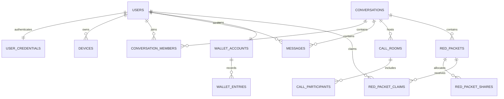

# 数据模型设计

## 1. 建模约定

- 主键使用 UUID/ULID；时间使用 UTC `timestamptz`，客户端按本地时区显示。
- 金额使用 `bigint` 整数分，禁止浮点数。
- 核心事实默认软删除或追加状态，不物理删除审计与账务数据。
- 所有可重试写请求使用唯一幂等键和数据库唯一约束。
- 表名为复数蛇形命名，示例字段省略通用的 `created_at/updated_at`。

## 2. 核心实体关系



## 3. 表设计

### 3.1 用户与设备

#### `users`

| 字段 | 类型 | 约束/说明 |
| --- | --- | --- |
| 字段 | 类型 | 约束/说明 |
| --- | --- | --- |
| `id` | uuid | PK |
| `username` | varchar(64) | UNIQUE，登录标识 |
| `email` | varchar(254) | 可空，登录标识之一。唯一性按 `lower(email)` 判定 |
| `display_name` | varchar(64) | 非空 |
| `avatar` | varchar(16) | 可空，展示名首字符占位 |
| `status` | enum | ACTIVE/FROZEN/DELETED |
| `last_seen_at` | timestamptz | 可空 |

邮箱的唯一索引建在 `lower(email)` 上且排除已删除账号：邮箱本地部分理论上
区分大小写，但实践中所有主流服务商都不区分，允许 `Alice@x.com` 和
`alice@x.com` 同时注册只会造成账号混淆和找回歧义。

#### `user_credentials`

密码凭证与 `users` 分表存储：`users` 会被大量只读查询命中（会话列表、成员展示），
凭证列跟着进缓存和日志的风险没有必要承担；后续接入短信/OAuth 时一个用户会有
多种凭证，分表是自然的扩展点。

| 字段 | 类型 | 约束/说明 |
| --- | --- | --- |
| `user_id` | uuid | PK，FK users |
| `password_hash` | text | BCrypt cost 12，含算法标识与 salt |
| `password_changed_at` | timestamptz | 审计与排查用（令牌失效由设备撤销保证） |
| `failed_attempts` | int | 连续失败次数，成功登录清零 |
| `locked_until` | timestamptz | 可空。锁定判定用 `locked_until > now()`，无需定时解锁任务 |
| `last_login_at` | timestamptz | 可空 |

失败计数与锁定存数据库而非 Redis：多实例下必须共享同一份计数才能真正限制撞库，
而 Redis 在本项目中是可降级组件（限流在故障时放行），把账号锁定建立在可降级的
存储上等于给撞库留了一个开关。

#### `devices`

| 字段 | 类型 | 约束/说明 |
| --- | --- | --- |
| `id` | varchar(128) | PK，客户端生成的稳定设备 ID |
| `user_id` | uuid | FK users |
| `platform` | enum | WEB/DESKTOP/IOS/ANDROID |
| `name` | varchar(128) | 用户可识别名称 |
| `refresh_token_hash` | text | 仅保存哈希 |
| `last_active_at` | timestamptz | 非空 |
| `revoked_at` | timestamptz | 可空 |

索引：`(user_id, last_active_at desc)`。

### 3.2 会话与消息

#### `conversations`

| 字段 | 类型 | 约束/说明 |
| --- | --- | --- |
| `id` | uuid | PK |
| `type` | enum | DIRECT/GROUP |
| `title` | varchar(50) | 群聊必填 |
| `owner_id` | uuid | 群主，可空 |
| `next_seq` | bigint | 下一个消息序号，事务内更新 |
| `last_message_id` | uuid | 可空 |
| `last_active_at` | timestamptz | 排序依据 |

单聊额外使用 `direct_conversation_keys(user_low_id, user_high_id)` 唯一约束，保证相同两人只有一个有效单聊。

#### `conversation_members`

| 字段 | 类型 | 约束/说明 | 是否已被代码使用 |
| --- | --- | --- | --- |
| `conversation_id` | uuid | 联合 PK/FK | ✅ |
| `user_id` | uuid | 联合 PK/FK | ✅ |
| `role` | enum | MEMBER/ADMIN/OWNER，权限矩阵见 `MemberRole` | ✅ |
| `joined_at` | timestamptz | 非空。复活退群成员时重置 | ✅ |
| `left_at` | timestamptz | 可空。退群是软删而非删行 | ✅ |
| `read_seq` | bigint | 默认 0。未读数 = `next_seq - 1 - read_seq` | ✅ |
| `join_seq` | bigint | 默认 0（V8）。历史可见下界 | ✅ |
| `muted` | boolean | 默认 false | ❌ 免打扰未实现 |
| `pinned_at` | timestamptz | 可空 | ❌ 会话置顶未实现 |

> **"是否已被代码使用"这一列是有意加的。** `role`、`muted`、`pinned_at` 自建表起就
> 存在，但直到补上会话成员管理之前**没有一行代码读写它们**——schema 里的取值会让人
> 相信能力存在，而能力并不存在（`users.status` 的 `'DELETED'` 曾经也是如此，
> 见 `AccountDeletionService` 的类注释）。新增预留字段时请一并标注状态。

**`join_seq` 的作用**：成员的历史消息可见下界。历史查询取
`max(afterSeq, join_seq)`，因此新成员看不到入群之前的消息，退群再入群的人也看不到
离开期间的消息。没有它的话"把某人加进群"等同于"把这个群的全部历史交给他"，
而加人只需要管理员权限、被泄露方毫无感知。存量成员取默认值 0（可见全部历史），
这对他们是正确的：迁移之前不存在加人路径，现有成员都是建群时就在的。

**退群为什么是软删**：`read_seq` / `join_seq` 需要保留，重新入群时是 UPDATE 而非
INSERT（`ON CONFLICT (conversation_id, user_id) DO UPDATE ... WHERE left_at IS NOT NULL`），
此时两个游标都重置为当时的序号。软删还保留了"这个人曾经在群里"的事实，
成员变更审计需要它。

#### `messages`

| 字段 | 类型 | 约束/说明 |
| --- | --- | --- |
| `id` | uuid | PK |
| `conversation_id` | uuid | FK |
| `seq` | bigint | 会话内序号 |
| `sender_id` | uuid | FK |
| `client_message_id` | varchar(128) | 客户端幂等键 |
| `type` | enum | TEXT/IMAGE/FILE/SYSTEM/CALL/RED_PACKET |
| `content` | jsonb | 按类型校验的负载 |
| `status` | enum | ACTIVE/RECALLED/DELETED |
| `sent_at` | timestamptz | 服务端时间 |

唯一约束：`(conversation_id, seq)`、`(sender_id, client_message_id)`；历史索引：`(conversation_id, seq desc)`。

### 3.3 通话

#### `call_rooms`

| 字段 | 类型 | 说明 |
| --- | --- | --- |
| `id` | uuid | PK |
| `conversation_id` | uuid | FK |
| `creator_id` | uuid | 发起人 |
| `media_type` | enum | AUDIO/VIDEO |
| `topology` | enum | MESH/SFU |
| `status` | enum | INVITING/RINGING/ACTIVE/ENDED/... |
| `expires_at` | timestamptz | 邀请超时 |
| `started_at` | timestamptz | 可空 |
| `ended_at` | timestamptz | 可空 |
| `end_reason` | varchar(64) | 可空 |

#### `call_participants`

| 字段 | 类型 | 说明 |
| --- | --- | --- |
| `room_id` | uuid | 联合 PK |
| `user_id` | uuid | 联合 PK |
| `state` | enum | INVITED/RINGING/JOINED/REJECTED/LEFT/MISSED |
| `joined_device_id` | varchar(128) | 实际接听设备，可空 |
| `joined_at/left_at` | timestamptz | 可空 |

### 3.4 钱包与红包

#### `wallet_accounts`

| 字段 | 类型 | 说明 |
| --- | --- | --- |
| `id` | uuid | PK |
| `user_id` | uuid | UNIQUE FK |
| `currency` | char(3) | 演示使用 CNY 单位体系 |
| `available_balance` | bigint | CHECK >= 0 |
| `frozen_balance` | bigint | CHECK >= 0 |
| `version` | bigint | 乐观锁版本 |

#### `wallet_transactions`

| 字段 | 类型 | 说明 |
| --- | --- | --- |
| `id` | uuid | PK |
| `type` | enum | RED_PACKET_SEND/CLAIM/REFUND/REVERSAL |
| `business_id` | uuid | 红包或冲正业务 ID |
| `idempotency_key` | varchar(128) | UNIQUE |
| `status` | enum | PENDING/COMMITTED/REVERSED |

#### `wallet_entries`

| 字段 | 类型 | 说明 |
| --- | --- | --- |
| `id` | uuid | PK |
| `transaction_id` | uuid | FK |
| `account_id` | uuid | FK |
| `direction` | enum | DEBIT/CREDIT |
| `amount` | bigint | CHECK > 0 |
| `balance_after` | bigint | 审计快照 |

事务内校验同一 `transaction_id` 借贷合计相等；真实资金系统建议使用独立复式记账服务，本模型只作为虚拟资产基线。

#### `red_packets`

| 字段 | 类型 | 说明 |
| --- | --- | --- |
| `id` | uuid | PK |
| `conversation_id` | uuid | FK |
| `sender_id` | uuid | FK |
| `mode` | enum | FIXED/EQUAL/RANDOM |
| `total_amount` | bigint | CHECK > 0 |
| `total_count` | int | CHECK > 0 |
| `claimed_amount/count` | bigint/int | 默认 0 |
| `greeting` | varchar(60) | 祝福语 |
| `status` | enum | CREATED/PUBLISHED/PARTIALLY_CLAIMED/EXHAUSTED/EXPIRED/REFUNDED |
| `expires_at` | timestamptz | 非空 |
| `idempotency_key` | varchar(128) | 与 sender 组成唯一键 |

#### `red_packet_shares`

| 字段 | 类型 | 说明 |
| --- | --- | --- |
| `id` | uuid | PK |
| `red_packet_id` | uuid | FK |
| `ordinal` | int | 与红包组成 UNIQUE |
| `amount` | bigint | CHECK > 0 |
| `claimed_by` | uuid | 可空 |
| `claimed_at` | timestamptz | 可空 |

#### `red_packet_claims`

| 字段 | 类型 | 说明 |
| --- | --- | --- |
| `id` | uuid | PK |
| `red_packet_id` | uuid | FK |
| `share_id` | uuid | UNIQUE FK |
| `user_id` | uuid | FK |
| `amount` | bigint | CHECK > 0 |
| `idempotency_key` | varchar(128) | 请求幂等键 |

唯一约束：`(red_packet_id, user_id)`、`(user_id, idempotency_key)`。

### 3.5 可靠事件与审计

#### `outbox_events`

字段包含 `id`、`aggregate_type`、`aggregate_id`、`event_type`、`payload jsonb`、`occurred_at`、`published_at`、`attempts`、`next_attempt_at`。索引未发布且到期事件。

#### `audit_logs`

字段包含 `id`、`actor_type/id`、`action`、`target_type/id`、`reason`、`request_id`、`ip_hash`、`metadata jsonb`、`created_at`。审计表只追加，限制访问与保留周期。

## 4. 关键事务伪代码

### 4.1 写消息

```text
BEGIN
  assert active membership
  return existing message if idempotency key exists
  lock conversation row
  seq = conversation.next_seq
  update conversation set next_seq = seq + 1
  insert message(seq, ...)
  insert outbox(MessageCreated, ...)
COMMIT
```

### 4.2 领取红包

```text
BEGIN
  lock red packet row
  assert eligible and not expired
  return existing claim for (packet, user) if present
  select one unclaimed share for update skip locked
  mark share claimed
  insert claim
  credit receiver account and append balanced ledger entries
  update packet counters/status
  insert outbox(RedPacketClaimed, ...)
COMMIT
```

## 5. 数据保留与删除

- 设备刷新令牌：退出后立即撤销，哈希最多保留安全审计周期。
- 消息：默认 365 天，可配置；删除账号时按隐私政策匿名化发送者展示信息。
- 通话信令：不持久化 SDP/ICE；通话元数据默认保留 180 天。
- 钱包、红包与审计：按虚拟资产和所在地法规设定，原则上不可由普通删除请求直接抹除。
- 对象存储：通过延迟删除任务与消息引用计数清理。
