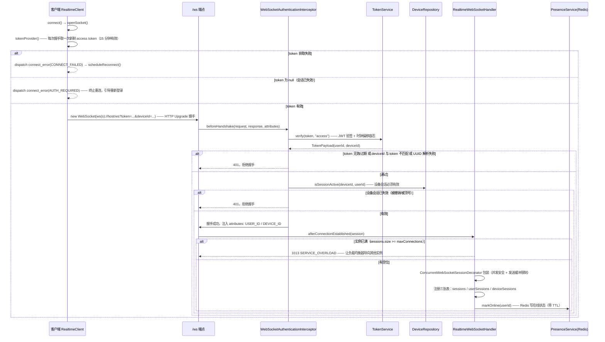
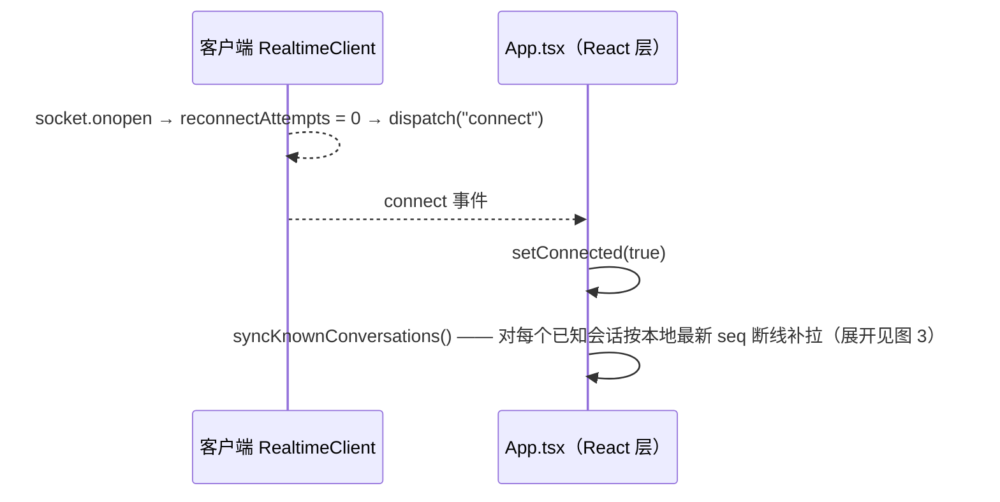
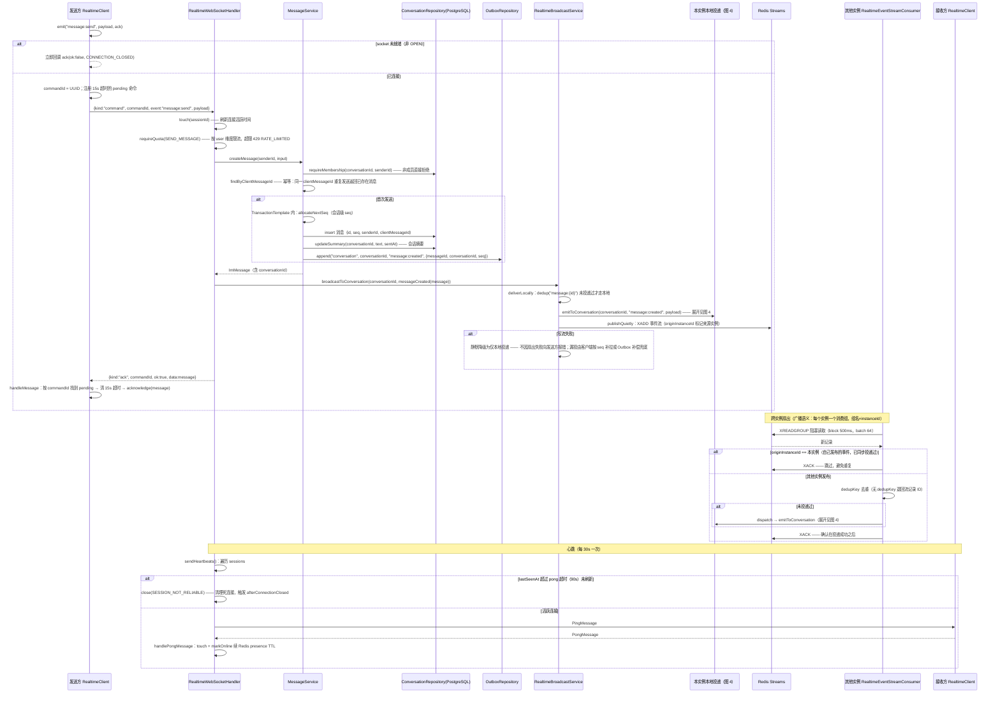
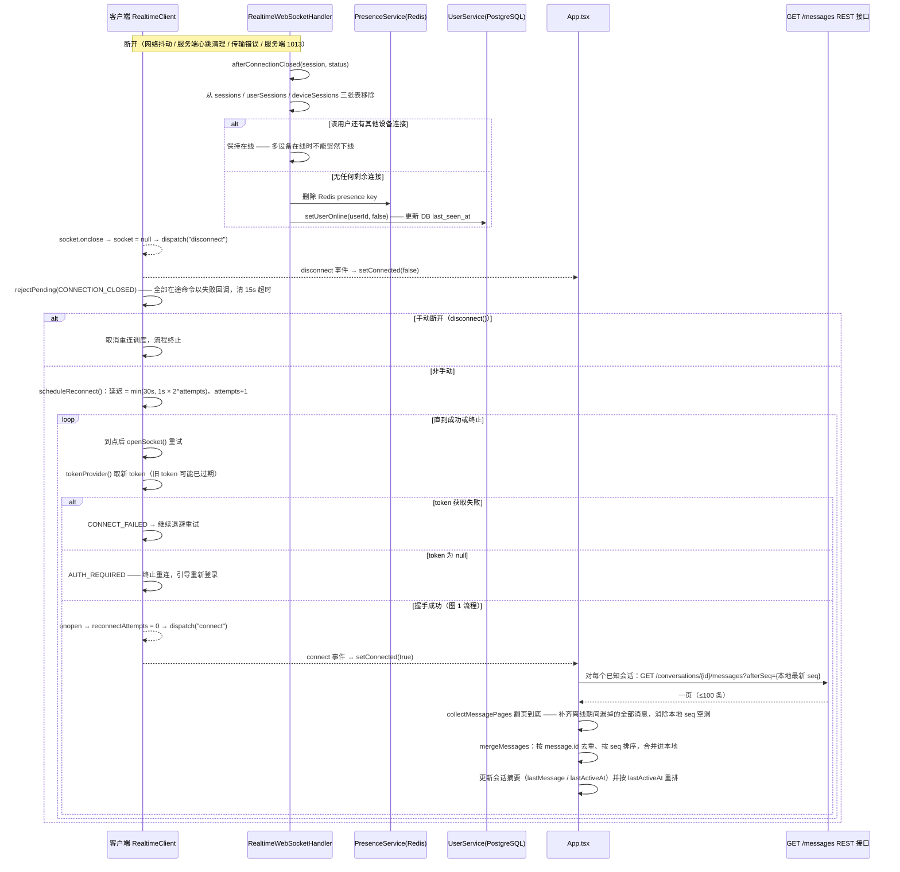
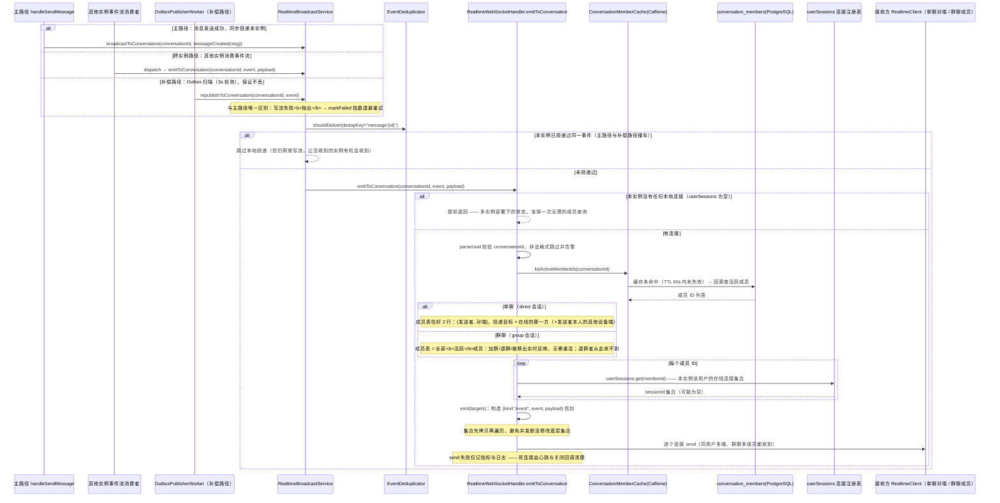
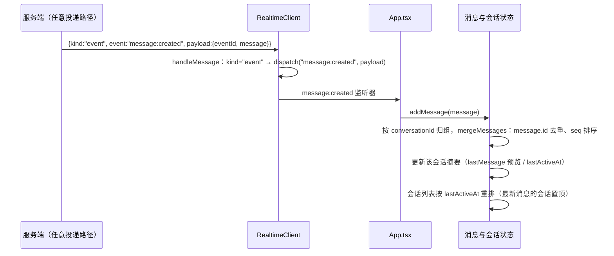

# WebSocket 实时链路时序图

> 基于当前实现（Redis Streams + 跨实例扇出改造完成后）梳理：连接建立、聊天消息全链路、断线重连与断线补拉、消息接收后的会话成员查找与投递。
> 相关源码：`apps/server/src/main/java/com/openim/server/realtime`、`apps/server/src/main/java/com/openim/server/config/WebSocketConfig.java`、`apps/web/src/realtime.ts`、`apps/web/src/messageSync.ts`、`apps/web/src/App.tsx`

## 系统组件总览

| 组件 | 职责 | 关键参数（默认值） |
|---|---|---|
| `RealtimeClient`（web） | 原生 WebSocket 客户端：连接/事件监听/命令发送/指数退避重连 | 命令超时 15s；重连 1s 起、翻倍、上限 30s |
| `WebSocketAuthenticationInterceptor` | 握手鉴权：校验 token + deviceId + 设备会话，注入会话属性 | 失败 401 拒绝握手 |
| `RealtimeWebSocketHandler` | 连接注册表（sessions / userSessions / deviceSessions）、命令分发、心跳、会话投递 | 单实例上限 10000；心跳 30s；pong 超时 90s |
| `RealtimeBroadcastService` | 统一两条投递路径：本实例同步投递 + Redis Stream 跨实例发布 | 去重只决定"本实例是否投递" |
| `RealtimeEventStream` | Redis Streams 事件流，所有实例共享一条流 | `openim:events:stream`，MAXLEN 10 万 |
| `RealtimeEventStreamConsumer` | 每实例一个消费组（组名=instanceId）做广播式消费，XACK 后置 | block 500ms、batch 64、XAUTOCLAIM 30s |
| `EventDeduplicator` | 本实例本地去重：优先业务 dedupKey（如 `message:{id}`），无则退回流记录 ID | — |
| `PresenceService` | 在线状态（Redis TTL） | — |
| `ConversationMemberCache` | 会话成员列表缓存：Caffeine 短 TTL + Redis Pub/Sub 失效广播，自愈 | TTL 60s、容量 2 万 |
| `MessageService` | 消息落库：成员校验、clientMessageId 幂等、事务内分配 seq、写 outbox | 只接受文本，1–4000 字符 |
| `OutboxPublisherWorker` | 补偿投递：扫描 outbox 记录，`republishToConversation` 重投 | 5s 轮询；写流失败抛异常 → markFailed 重试 |

## 图 1：WebSocket 连接建立（握手鉴权 + 连接注册）

> 要点：握手是 WebSocket 唯一的一次性鉴权入口，鉴权失败以 401 拒绝、不建连接；容量闸门以 1013 拒绝（语义是"稍后重试"，客户端指数退避是正确的响应）。注册顺序固定"先注册表、后 presence"，避免"presence 已在线而连接不可达"的投递空洞。

连接建立后客户端侧：

## 图 2：聊天消息全链路（发送 → 落库 → 广播 → ACK）+ 心跳

> 要点：命令帧带 `commandId`，任何失败（限流、校验、内部错误）都回带同一 id 的错误 ack，客户端据此把失败与具体请求对上；消息在落库成功后才广播、才回 ack——"发送成功"永远是诚实的结果。写流失败不抛出：主路径业务已成功，漏掉的跨实例投递由客户端按 `seq` 补拉或 `OutboxPublisherWorker` 补偿（写流失败必须抛出，驱动 `markFailed` 重试）。

## 图 3：连接断开、指数退避重连与断线补拉

> 要点：重连必须每次重新取 token（访问令牌只有 15 分钟有效，长断线后旧令牌已过期）；指数退避首次 1s、翻倍、上限 30s；1013（服务过载）与网络抖动一样自动重连，只有 AUTH_REQUIRED 是终止性错误。断线补拉只翻页到底（补齐空洞），打开会话走 `/messages/latest` 只取最新一页——客户端靠 `seq` 连续性判断有没有漏收。

## 图 4：消息接收后的逻辑与"channel"查找投递（单聊 / 群聊 / 设备）

> "channel"在本项目中即**会话（conversation）**：事件按会话投递，成员关系实时查库解析，不维护"会话 → 连接"的快照索引（快照在成员变动后会失效：新成员收不到、退群者仍在收）。投递入口有三条路径，最终都落到本图的 `emitToConversation`。

> 要点：
> - **单聊 vs 群聊的差别不在投递逻辑，而在成员集合**：单聊是 2 人集合，群聊是 N 人活跃集合；`emitToConversation` 对两者走同一条"查库解析成员 → 注册表路由"路径，因此单聊创建时无需专门为投递做任何事。
> - 成员查询走 Caffeine 缓存（TTL 60s + 建群/加人/退群/移出时经 Redis Pub/Sub 失效广播主动清除）；缓存与"连接时快照"的关键区别是**自愈**——即使失效广播丢失，陈旧窗口也止于一个 TTL，而快照的错误会持续到连接断开。
> - 成员变更场景（`conversation:members-changed`）客户端收到后只重拉该会话；实时投递侧的成员关系更新由缓存失效承担。
> - **设备级 channel**（RTC 信令）：`broadcastToDevice(userId, deviceId, ...)` 按 `deviceSessions` 索引精确路由到指定设备，不查成员表；信令目标设备在其他实例时同样经 Redis Stream 转发。

客户端接收消息后：

> 客户端与服务端共用同一个去重标识：服务端 dedupKey = `message:{id}`，客户端按 `message.id` 去重——同一条消息被补偿路径重投时，两端各自挡住重复。
