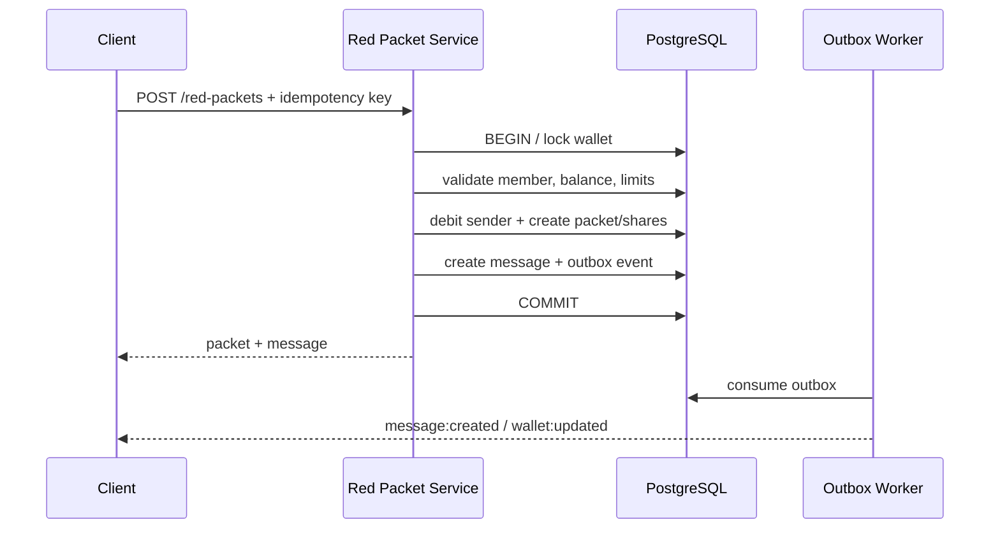

# 红包与虚拟账务专项设计

## 1. 安全边界

首版红包仅使用系统内虚拟余额，用于演示产品交互和并发一致性，不连接真实资金。若未来接入充值、提现、银行卡或法币，必须将钱包拆为受监管的独立账务域，并重新完成实名、反洗钱、支付合规、对账、灾备与审计设计。

## 2. 红包类型

| 场景 | 模式 | 规则 |
| --- | --- | --- |
| 单聊 | FIXED | 1 份，仅对方可领，金额固定 |
| 群聊等额 | EQUAL | 总额按份数分配，余数确定性分摊 |
| 群聊拼手气 | RANDOM | 预分配随机份额，每份至少 1 分 |

默认限制：单个红包 1–20,000 分、1–100 份、祝福语最多 60 字符、24 小时过期。所有限制由服务端配置并返回给客户端，客户端校验只用于即时反馈。

## 3. 金额与账务原则

- 金额始终使用 64 位整数最小单位，禁止 `number` 浮点运算进入核心账务；TypeScript 边界需限制在安全整数范围，数据库使用 `bigint`。
- 余额变化必须对应一笔业务交易和不可变账务分录。
- 每笔交易通过幂等键唯一；失败重试返回原结果。
- 账务纠错使用反向分录，不更新/删除历史分录。
- 红包事实、领取事实和对应余额变化必须在同一数据库事务中提交。
- 对账任务定期校验红包总额 = 已领取金额 + 已退款金额 + 未处理金额。

## 4. 随机金额算法

创建红包时预分配全部份额并随机打乱，领取只消费一个未领取份额，缩短锁持有时间并便于审计。

约束随机算法：设剩余金额 `R`、剩余份数 `N`、每份下限 `m=1` 分。当前份额从 `[m, min(R - (N-1)m, 2R/N)]` 取安全随机整数；最后一份得到全部剩余金额。生成结束后必须断言：

- 份额数量等于 `totalCount`；
- 每份 ≥ 1 分；
- 所有份额之和精确等于 `totalAmount`。

演示可使用加密安全随机数；自动化测试注入可重复随机源。算法的“随机”只影响娱乐展示，不承诺统计学公平或博彩用途。

## 5. 发送流程

先扣款后发消息但两者同事务写入事实；在线广播由 Outbox 完成。如果广播失败，客户端仍可通过会话同步取得红包卡片。

## 6. 领取事务与并发控制

数据库事务按以下顺序获取锁，防止死锁：红包 → 份额 → 接收者钱包。

1. 读取幂等结果；若已存在直接返回。
2. 锁定红包，校验状态、过期时间、会话资格和是否已领取。
3. 使用 `FOR UPDATE SKIP LOCKED` 选择一个未领取份额。
4. 标记份额并插入唯一领取记录。
5. 增加接收者余额，写入账务交易/分录。
6. 原子更新红包计数；最后一份将状态置为 `EXHAUSTED`。
7. 写 Outbox 后提交。

数据库唯一约束是最终防线：`(red_packet_id, user_id)` 防重复领，`share_id UNIQUE` 防一份多领。应用层检查不能替代约束。

## 7. 过期退款

- Worker 周期性锁定 `expires_at <= now()` 且仍可领取的红包。
- 与领取使用同样的红包锁，因此某一份只能先被领取或后被退款。
- 计算未领取份额总额，创建唯一退款交易并返还发送者。
- 将未领取份额标记为已关闭，红包经 `EXPIRED` 进入 `REFUNDED`。
- 写 Outbox 更新卡片和发送者钱包；任务重试只返回同一退款交易。

## 8. 风控规则

### 发送前

- 账号/钱包未冻结，设备和会话可信。
- 单笔、单日累计、频次和收件群规模符合策略。
- 新设备、异常 IP、短时高频等触发二次验证或冷却。

### 领取时

- 当前用户具有会话领取资格且未被限制。
- 同设备/网络批量账号、自动化高频、异常成功率可进入风控队列。
- 风控超时时默认不产生资金结果；返回可重试/人工检查状态。

### 管理

- 管理员不能直接编辑余额或领取记录。
- 冻结、解冻、冲正都需要原因和审计记录；高金额操作建议双人复核。

## 9. 客户端状态

| 状态 | 卡片展示 | 点击行为 |
| --- | --- | --- |
| PUBLISHED | 红色可领取 | 打开领取弹窗 |
| PARTIALLY_CLAIMED | 显示剩余/已领 | 未领用户可领，已领用户看详情 |
| EXHAUSTED | 已领完 | 查看领取明细 |
| EXPIRED/REFUNDED | 已过期 | 查看明细和退款状态 |

领取请求超时后展示“结果确认中”，使用同一幂等键重试或拉取详情。客户端不得因 HTTP 超时直接宣告失败或再次生成新领取请求。

## 10. 测试重点

- 属性测试：随机分配份数、最小值和总额始终满足约束。
- 幂等测试：发送/领取/退款重复调用不新增事实。
- 并发测试：最后 1 份被 20/100 个请求竞争时恰好 1 个成功。
- 竞争测试：领取与过期任务并发时不重复入账。
- 故障测试：事务中断、Outbox 失败、Worker 重启后余额和卡片可恢复。
- 对账测试：任意操作序列后账户分录平衡，红包资金守恒。
