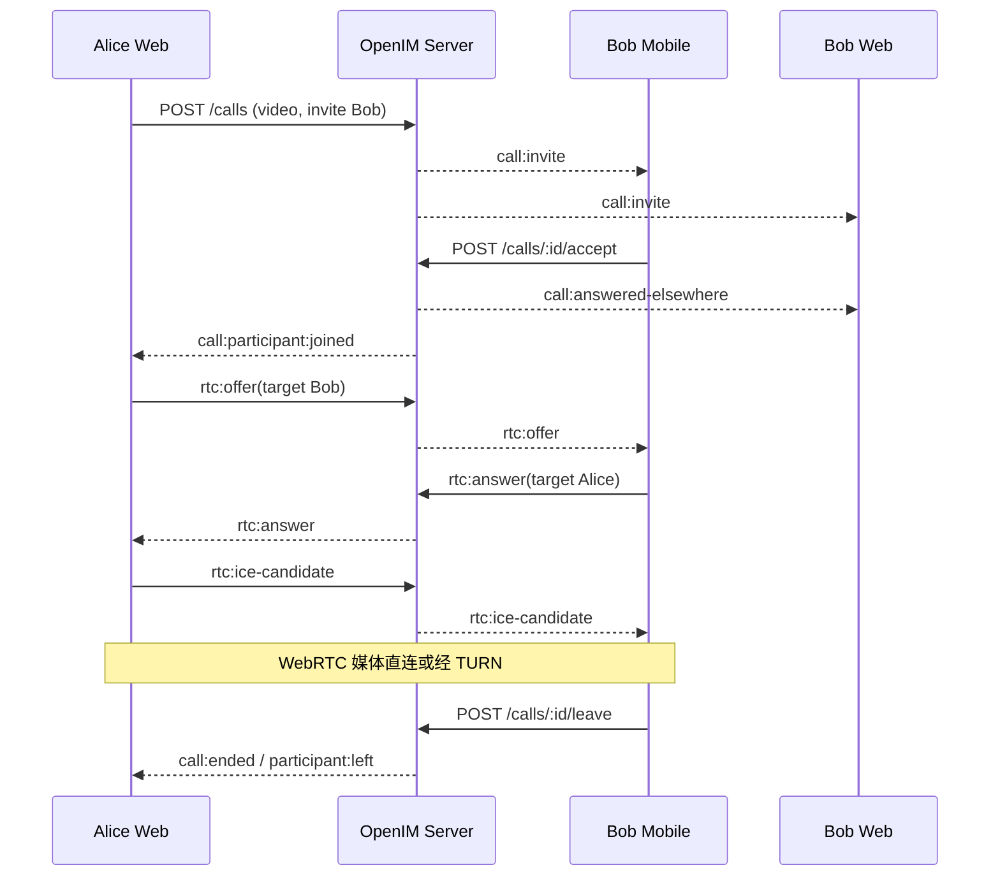

# 多端语音/视频通话专项设计

## 1. 范围与目标

首版支持单聊一对一、群聊 2–6 人语音/视频通话，以及同一账号多设备响铃、单设备接听。Web 客户端通过 WebRTC 传输媒体，服务端负责房间权限、状态机和 SDP/ICE 信令转发，不保存或录制媒体。

## 2. 拓扑选择

### MVP：Mesh

每个参与者与其他参与者建立 `RTCPeerConnection`。优点是无需媒体服务器、易于本地验证；代价是每端上传带宽和编码压力随人数线性增长，因此硬上限为 6 人，建议视频 4 人以内。

### 生产：SFU

超过 6 人、移动弱网或需要屏幕共享时，接入 LiveKit/mediasoup。客户端只向 SFU 上传一路媒体，由 SFU 转发订阅层。业务房间 ID、邀请、成员权限和通话记录继续由 OpenIM 管理，媒体服务使用映射 ID 和短期入会令牌。

## 3. 组件职责

| 组件 | 职责 |
| --- | --- |
| 设备预检 | 枚举设备、请求权限、预览、保存用户偏好 |
| Call Store | 房间/参与者/邀请/通话计时与 UI 状态 |
| Signaling Client | 发送/接收房间和 SDP/ICE 事件，处理重连 |
| Peer Manager | 每个远端用户维护连接、轨道、协商与 ICE restart |
| Call Service | 权限、状态机、多设备收敛、信令路由 |
| SFU/TURN | 生产媒体转发和 NAT 穿透，不处理红包/消息业务 |

## 4. 呼叫时序

## 5. WebRTC 协商规则

- 每个房间参与者使用稳定的 `participantId`，同账号多端只有接听设备成为媒体参与者。
- 使用 Perfect Negotiation 模式避免双方同时创建 offer 的 glare；以稳定用户/参与者 ID 决定 polite peer。
- ICE candidate 在设置远端描述前暂存，设置成功后按序加入。
- `RTCPeerConnection` 配置从服务端拉取短期 STUN/TURN 凭证，禁止在前端仓库硬编码长期 TURN 密码。
- 音频默认 Opus；视频优先 VP8/H.264，具体由浏览器协商。
- 关闭摄像头优先切换 track `enabled`，切换设备使用 `replaceTrack`，避免不必要的重协商。
- 连接进入 `failed` 时执行一次 ICE restart；`disconnected` 超过 10 秒再判定失败。

## 6. 房间与参与者状态机

### 房间

- `INVITING`：已创建，尚未向全部目标发出邀请。
- `RINGING`：至少一名目标正在响铃。
- `ACTIVE`：至少两名成员已加入。
- `ENDED`：所有人离开、超时、取消或系统关闭。

### 参与者

- `INVITED → RINGING → JOINED → LEFT`
- 拒绝：`RINGING → REJECTED`
- 未接：`RINGING → MISSED`
- 其他设备接听：该账号其余设备只是停止本地响铃，不新增业务参与者。

## 7. 权限与隐私

- 浏览器权限必须由用户手势触发；预检失败不自动无限重试。
- 摄像头/麦克风默认关闭策略可配置；加入视频通话前明确展示预览。
- 服务端只转发有限大小信令，并校验房间成员，防止任意用户借信令通道互发数据。
- 不在服务端日志保存 SDP/ICE；这些内容可能泄露网络和设备信息。
- 屏幕共享、录制、实时字幕属于后续显式授权功能，首版不静默启用。

## 8. 弱网与重连

| 现象 | 处理 |
| --- | --- |
| WebSocket 短暂断开，媒体仍通 | 保持媒体，恢复信令后同步房间状态 |
| 媒体 `disconnected` | 展示“网络不稳定”，等待 10 秒并采集 stats |
| 媒体 `failed` | 发起一次 ICE restart；失败后允许手动重试 |
| 页面刷新 | 旧设备参与连接清理，新连接通过房间 API 尝试恢复 |
| 切网 | ICE restart，必要时经 TURN relay |
| 目标离线 | 保留邀请等待离线推送；超时后记录未接 |

## 9. 质量指标

- 呼叫邀请到达延迟 P95 < 500 ms。
- 接听到首帧/首个音频包 P95 < 3 秒（受控网络）。
- 建连成功率 ≥ 98%（配置 TURN 的受控网络）。
- 统计 `candidate-pair`、RTT、丢包、抖动、码率、帧率和冻结时间，但不上报媒体内容。
- 房间结束原因必须可区分：正常离会、拒绝、取消、超时、网络失败、服务端关闭。

## 10. 测试矩阵

- 浏览器：Chrome、Edge、Safari 最近两个大版本。
- 场景：同网直连、不同 NAT、仅 relay、Wi-Fi/蜂窝切换、摄像头被占用、权限拒绝。
- 人数：1:1、3 人、6 人；加入/离开/重复加入/发起人先离开。
- 设备：同账号两标签页、网页 + 移动端（具备客户端后）。
- 音视频：静音、关摄像头、切设备、纯音频、视频降级。

## 11. MVP 与生产差异

MVP 的 WebSocket 信令和 Mesh 实现用于验证产品交互，不代表公网质量。生产上线通话前必须部署 TURN，压测带宽，完成浏览器/移动兼容矩阵，并在目标人数或网络模型超过 Mesh 边界时接入 SFU。
